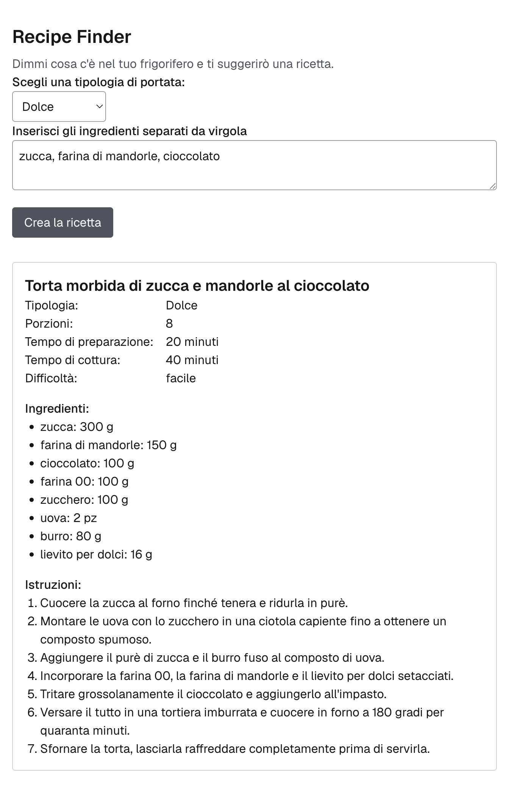

# Recipe Finder
Write the ingredients you have, get the recipe generated by AI.

**Live demo:** [recipe-finder-fc.vercel.app](https://recipe-finder-fc.vercel.app) (interface in Italian)



## Stack
Next.js 16 · TypeScript · Tailwind CSS 4 · Zod 4 · Vercel AI SDK 7 · Gemini 3.5 Flash-Lite · Vercel

## Key decisions
- Structured output: one Zod schema validates the form and tells Gemini which recipe structure to return.
- The model can say "no": if no ingredient is real food, it returns a reason instead of inventing a recipe.
- Errors handled for the user: clear messages for rate limits, timeout (45s) and service errors.

## Known limitations
- Uses Gemini 3.5 Flash-Lite: fast and available on the free tier. Gemini 3.8 Flash gives better recipes but returned 503 errors for days, so it is not used in production.
- For testing the larger model locally, set `GEMINI_MODEL=gemini-3.8-flash` in `.env.local`.
- No streaming yet: the recipe appears only when it is complete. Planned for the next version.

## How it was built
About 21 hours of effective work, planned as GitHub issues with one branch and one pull request each. 
Design decisions are recorded in `docs/decisions/`.

## Run locally
```bash
pnpm install
cp .env.example .env.local   # add your Gemini API key
pnpm dev
```

## Template notes
This project was bootstrapped with [`create-next-app`](https://nextjs.org/docs/app/api-reference/cli/create-next-app).
- `pnpm dev` starts the dev server on `localhost:3000`; the page auto-updates as you edit `app/page.tsx`.
- This project uses [`next/font`](https://nextjs.org/docs/app/building-your-application/optimizing/fonts) to automatically optimize and load [Geist](https://vercel.com/font), a new font family for Vercel.
- Learn more: [Next.js Documentation](https://nextjs.org/docs) · [Next.js Learn](https://nextjs.org/learn) · [Deploy on Vercel Platform](https://vercel.com/new?utm_medium=default-template&filter=next.js&utm_source=create-next-app&utm_campaign=create-next-app-readme)